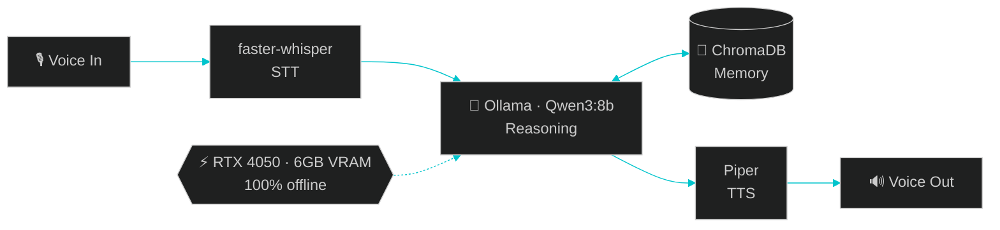
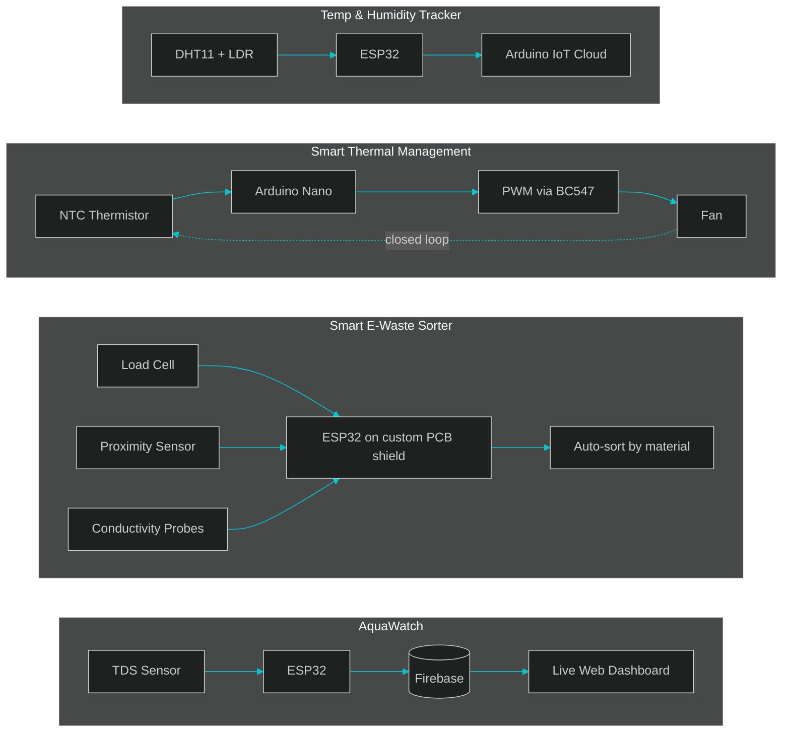
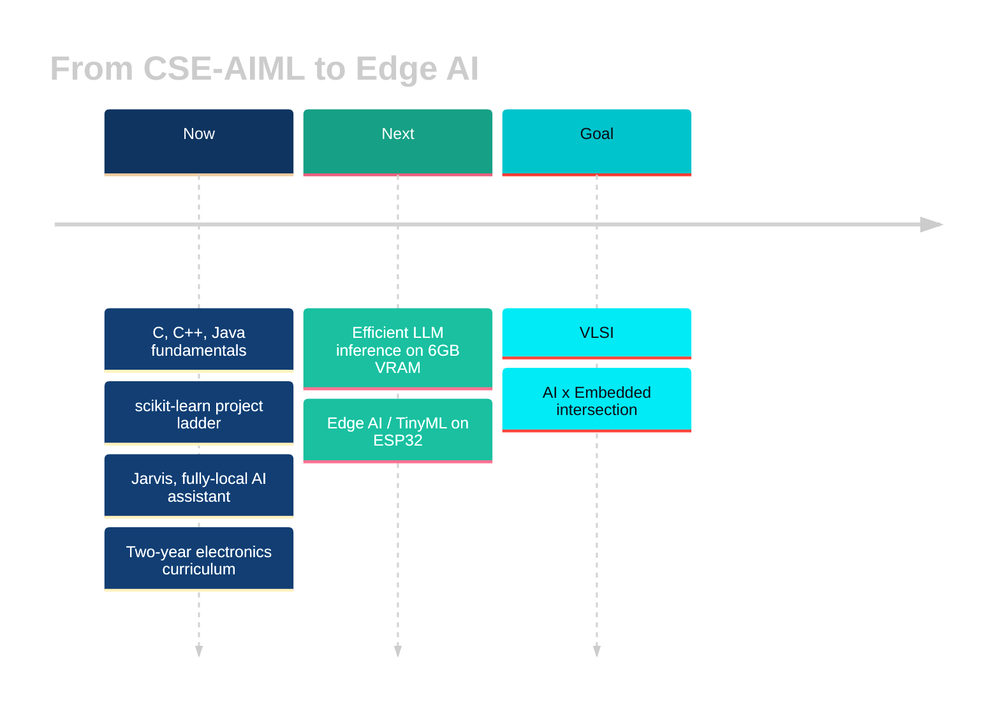

 

## 💫 About Me

> 2nd-year B.Tech **CSE (AI & ML)** student at **SRM Institute of Science and Technology**.
> I split my time between **AI systems that run fully offline** and **embedded/IoT hardware that mostly doesn't** — the intersection is where I want to end up.

<table>
<tr>
<td width="50%" valign="top">

### 🔭 Currently working on
**Jarvis** — a locally-run AI assistant:
- 🧠 **Ollama (Qwen3:8b)** for reasoning
- 💾 **ChromaDB** for memory
- 🔊 **Piper** for TTS
- 🎙️ **faster-whisper** for STT
- 🖥️ Fully offline on an **RTX 4050 (6GB VRAM)**

Also sharpening **C, C++, and Java** fundamentals.

</td>
<td width="50%" valign="top">

### 🤝 Looking to collaborate on
**Edge AI / TinyML** — ESP32-class devices running lightweight inference instead of just streaming sensor data to the cloud.

Also open to **IoT builds** with PCB design and real-time dashboards (see AquaWatch and the e-waste sorter below).

</td>
</tr>
<tr>
<td width="50%" valign="top">

### 🆘 Looking for help with
Running **local LLM inference** efficiently on a VRAM-constrained 6GB GPU — quantization, context management, latency tuning.

Also open to feedback on my **six-peripheral ESP32 PCB shield** design.

</td>
<td width="50%" valign="top">

### 🌱 Currently learning
- C, C++, and Java alongside AI/ML coursework
- Machine learning with **scikit-learn** via a structured Python project ladder
- A self-designed **two-year electronics curriculum** heading toward **Edge AI/TinyML and VLSI**

</td>
</tr>
</table>

### 💬 Ask me about
`Fully-local AI assistants` · `ESP32-based IoT systems` · `Water quality` · `E-waste sorting` · `Thermal management` · `PCB design in EasyEDA` · `Self-studying electronics alongside a CSE-AIML degree`

## 🧠 Jarvis — Architecture

## 🚀 Featured Projects

<table>
<tr>
<td width="50%" valign="top">

### 💧 AquaWatch
**IoT Smart Water Quality Monitoring System**

ESP32 + TDS sensor + Firebase with a live web dashboard.

`ESP32` `TDS Sensor` `Firebase` `Web Dashboard`

📄 IEEE paper + conference poster

</td>
<td width="50%" valign="top">

### ♻️ Smart E-Waste Sorting System

ESP32 with a load cell, proximity sensor, and conductivity probes to auto-sort waste by material, on a custom PCB shield.

`ESP32` `Load Cell` `Proximity` `Conductivity` `PCB`

📄 IEEE paper with three classmates

</td>
</tr>
<tr>
<td width="50%" valign="top">

### 🔌 Custom ESP32 Sensor Shield (PCB)

Six-peripheral shield with a dual power rail, designed in **EasyEDA** to standardize the sensor stack across my IoT projects.

`EasyEDA` `ESP32` `Dual Power Rail`

</td>
<td width="50%" valign="top">

### 🌡️ Smart Thermal Management System

Arduino Nano + NTC thermistor + PWM fan control via a BC547 transistor, closed-loop.

`Arduino Nano` `NTC` `PWM` `BC547`

📄 Conference poster

</td>
</tr>
<tr>
<td colspan="2" valign="top">

### 📡 Live Temperature & Humidity Tracking System

ESP32 + DHT11 + LDR streaming to Arduino IoT Cloud for remote monitoring.

`ESP32` `DHT11` `LDR` `Arduino IoT Cloud` · 📄 Conference poster

</td>
</tr>
</table>

<b>🔬 Click to expand — system data flows</b>

 

## 📄 Papers & Presentations

| 📑 Work | 🏷️ Type |
|:--|:--|
| **AquaWatch** | IEEE-format paper · Conference poster |
| **Smart E-Waste Sorting System** | IEEE-format paper |
| **Smart Thermal Management** | Conference poster |
| **Temperature / Humidity Tracker** | Conference poster |
| **LLM-OS: Reimagining Resource Management for the AI Era** | Class presentation poster + slide deck — AIOS kernel architecture, hierarchical context memory management, agent scheduling |

## 🗺️ Roadmap

## 💻 Tech Stack

  

## 🎮 Also Into

## 📊 GitHub Stats

 

 

### 📈 Contribution Graph

### 🐍 Contribution Snake

<picture>
  <source media="(prefers-color-scheme: dark)" srcset="https://raw.githubusercontent.com/SinghAgambir05/SinghAgambir05/output/github-snake-dark.svg" />
  <source media="(prefers-color-scheme: light)" srcset="https://raw.githubusercontent.com/SinghAgambir05/SinghAgambir05/output/github-snake.svg" />
  
</picture>

### 🏆 Trophies

### 🔝 Top Contributed Repo

### ✍️ Random Dev Quote

### 📬 Let's build something

