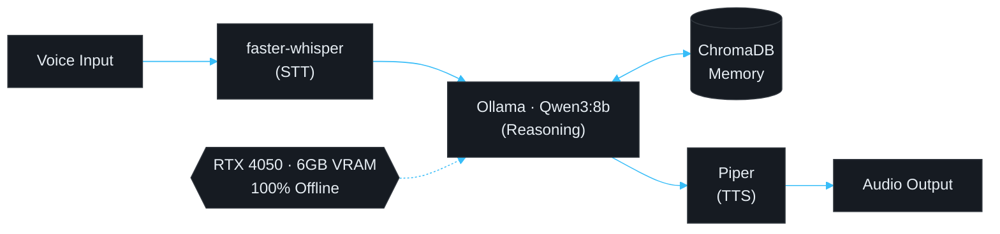
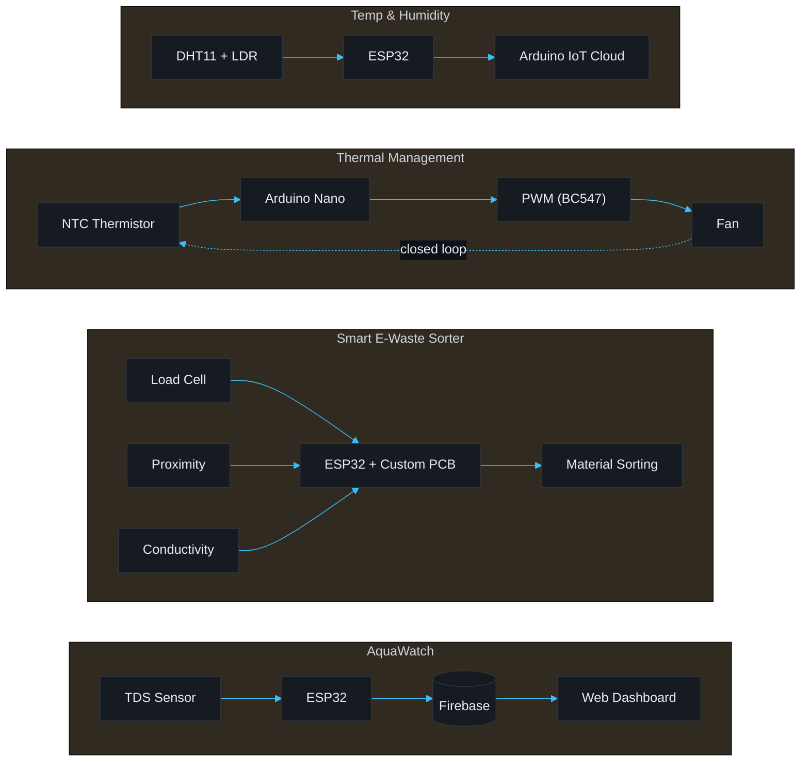
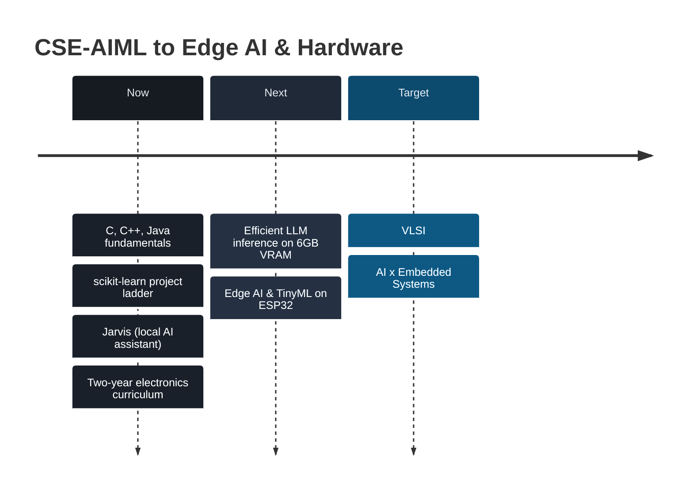

# Agambir Singh Jammu

**Local AI Systems · Embedded Hardware · CSE (AI & ML) @ SRMIST**

Building offline-first AI assistants on constrained VRAM and designing custom ESP32 hardware—working toward the intersection of Edge AI, TinyML, and VLSI.

 

---

### Overview

<table>
<tr>
<td width="50%" valign="top">

**Currently Building**  
**Jarvis** — a fully offline voice assistant running on an **RTX 4050 (6GB VRAM)** using `Ollama (Qwen3:8b)` for reasoning, `ChromaDB` for memory, `faster-whisper` for STT, and `Piper` for TTS.

</td>
<td width="50%" valign="top">

**Currently Learning**  
Sharpening **C, C++, and Java** fundamentals, working through a structured `scikit-learn` project track, and following a self-designed **two-year electronics curriculum** toward TinyML and VLSI.

</td>
</tr>
<tr>
<td width="50%" valign="top">

**Open to Collaborate**  
**Edge AI / TinyML** projects where ESP32-class microcontrollers run lightweight inference locally instead of just streaming raw sensor data to the cloud, plus PCB-backed IoT systems.

</td>
<td width="50%" valign="top">

**Looking for Feedback On**  
Optimizing **local LLM inference on 6GB VRAM** (quantization, context management, latency tuning) and reviewing my **six-peripheral ESP32 PCB shield** layout.

</td>
</tr>
</table>

---

### Jarvis — Local Pipeline

---

### Featured Projects

<table>
<tr>
<td width="50%" valign="top">

#### AquaWatch
**IoT Smart Water Quality Monitoring System**  
ESP32 + TDS sensor streaming real-time water quality metrics to Firebase and a live web dashboard.

`ESP32` `TDS Sensor` `Firebase` `Web Dashboard`  
*Published: IEEE-format paper & conference poster*

</td>
<td width="50%" valign="top">

#### Smart E-Waste Sorting System
**Automated Material Classification**  
ESP32 paired with a load cell, proximity sensor, and conductivity probes on a custom PCB shield to auto-sort waste by material.

`ESP32` `Load Cell` `Proximity` `Conductivity` `PCB`  
*Published: Co-authored IEEE-format paper*

</td>
</tr>
<tr>
<td width="50%" valign="top">

#### Custom ESP32 Sensor Shield
**Standardized IoT Hardware Platform**  
Six-peripheral shield with a dual power rail, designed in **EasyEDA** to standardize sensor wiring across my hardware builds.

`EasyEDA` `ESP32` `Dual Power Rail` `PCB Design`

</td>
<td width="50%" valign="top">

#### Smart Thermal Management System
**Closed-Loop Cooling Controller**  
Arduino Nano reading an NTC thermistor to drive a PWM fan via a BC547 transistor in a closed feedback loop.

`Arduino Nano` `NTC Thermistor` `PWM` `BC547`  
*Presented: Conference poster*

</td>
</tr>
<tr>
<td colspan="2" valign="top">

#### Live Temperature & Humidity Tracker
ESP32 with DHT11 and LDR sensors streaming environmental telemetry to Arduino IoT Cloud for remote monitoring.

`ESP32` `DHT11` `LDR` `Arduino IoT Cloud` · *Presented: Conference poster*

</td>
</tr>
</table>

<b>View System Data Flows</b>

 

---

### Papers & Presentations

| Title | Format | Focus |
| :--- | :--- | :--- |
| **LLM-OS: Reimagining Resource Management for the AI Era** | Poster + Slide Deck | AIOS kernel architecture, hierarchical context memory, agent scheduling |
| **AquaWatch** | IEEE Paper + Poster | Real-time IoT water quality telemetry |
| **Smart E-Waste Sorting System** | IEEE Paper | Multi-sensor automated material classification |
| **Smart Thermal Management** | Conference Poster | Closed-loop PWM thermal control |
| **Temperature / Humidity Tracker** | Conference Poster | Cloud-connected environmental monitoring |

---

### Roadmap

---

### Tech Stack

| Domain | Technologies |
| :--- | :--- |
| **Languages** |     |
| **AI & Local ML** |     |
| **Embedded & Cloud** |     |
| **Tools & Off-Clock** |      |

---

### GitHub Activity

 

  

<picture>
  <source media="(prefers-color-scheme: dark)" srcset="https://raw.githubusercontent.com/SinghAgambir05/SinghAgambir05/output/github-snake-dark.svg" />
  <source media="(prefers-color-scheme: light)" srcset="https://raw.githubusercontent.com/SinghAgambir05/SinghAgambir05/output/github-snake.svg" />
  
</picture>

---

  Working on Edge AI, TinyML, custom PCBs, or squeezing LLMs onto 6GB VRAM? <a href="mailto:kingagambir@gmail.com">Reach out.</a>

